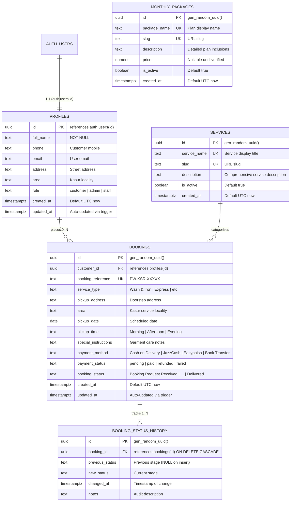

# Pickup Wash - Supabase PostgreSQL Database Architecture

**Location:** Kasur City, Pakistan  
**Database Engine:** PostgreSQL 15+ (via Supabase)  
**Schema Version:** `20261103000001`  
**Compatibility:** Supabase Free and Pro Tiers  

---

## 1. Executive Architecture Summary

The Pickup Wash database architecture is engineered specifically for doorstep laundry pickup and delivery operations in Kasur City, Pakistan. It enforces **strict customer data isolation** via Supabase Row Level Security (RLS), **transparent audit trails** through automated triggers, and **clean separation between operational orders and service catalogs**.

### Architectural Tenets
1. **Zero Price Invention:** Service rates and monthly packages are not assumed or fabricated. All monthly package prices remain `NULL` until confirmed by management, aligning with the customer-facing message: *"Contact Us for Current Rates"*.
2. **Real Data Integrity:** No synthetic test accounts or simulated orders exist in the canonical database migrations.
3. **Automated Audit Logging:** Every lifecycle transition (from *"Booking Request Received"* through *"Delivered"*) is automatically logged into `booking_status_history` via a PostgreSQL database trigger.
4. **Security by Default:** All tables have Row Level Security enabled. Customers can only read and modify their own records. Public tracking requires verification of both booking reference and matching phone number.

---

## 2. Entity-Relationship (ER) Diagram



---

## 3. Data Dictionary

### 3.1 `public.profiles`
Stores extended customer and administrative profile attributes linked 1:1 with Supabase Auth (`auth.users`).

| Column | Type | Constraints | Default | Description |
| :--- | :--- | :--- | :--- | :--- |
| `id` | `UUID` | `PRIMARY KEY`, `REFERENCES auth.users(id) ON DELETE CASCADE` | — | Supabase Auth user identifier |
| `full_name` | `TEXT` | `NOT NULL` | — | Customer full legal/preferred name |
| `phone` | `TEXT` | Nullable | — | Contact telephone/WhatsApp number |
| `email` | `TEXT` | Nullable | — | Contact email address |
| `address` | `TEXT` | Nullable | — | Default street address in Kasur |
| `area` | `TEXT` | Nullable | — | Default Kasur locality/neighborhood |
| `role` | `TEXT` | `NOT NULL`, `CHECK (role IN ('customer', 'admin', 'staff'))` | `'customer'` | Role-based authorization tier |
| `created_at` | `TIMESTAMPTZ` | `NOT NULL` | `timezone('utc'::text, now())` | Record creation timestamp |
| `updated_at` | `TIMESTAMPTZ` | `NOT NULL` | `timezone('utc'::text, now())` | Record update timestamp |

---

### 3.2 `public.bookings`
Core transaction table capturing pickup requests, scheduling, addresses, and workflow lifecycle status.

| Column | Type | Constraints | Default | Description |
| :--- | :--- | :--- | :--- | :--- |
| `id` | `UUID` | `PRIMARY KEY` | `gen_random_uuid()` | Unique booking identifier |
| `customer_id` | `UUID` | `REFERENCES public.profiles(id) ON DELETE SET NULL` | — | Registered customer ID (null for guest checkout) |
| `booking_reference` | `TEXT` | `NOT NULL`, `UNIQUE` | — | Human-friendly tracking reference (e.g. `PW-KSR-10492`) |
| `service_type` | `TEXT` | `NOT NULL` | — | Service name (e.g. `Wash & Iron`, `Express Service`, `Monthly Package`) |
| `pickup_address` | `TEXT` | `NOT NULL` | — | Customer street and landmark address |
| `area` | `TEXT` | `NOT NULL` | — | Kasur service area / neighborhood |
| `pickup_date` | `DATE` | `NOT NULL` | — | Scheduled date of doorstep laundry pickup |
| `pickup_time` | `TEXT` | `NOT NULL` | — | Preferred time slot (e.g. `Morning (8:00 AM - 12:00 PM)`) |
| `special_instructions`| `TEXT` | Nullable | — | Specific garment handling instructions |
| `payment_method` | `TEXT` | `NOT NULL`, `CHECK IN ('Cash on Delivery', 'JazzCash', 'Easypaisa', 'Bank Transfer')` | `'Cash on Delivery'` | Selected payment method |
| `payment_status` | `TEXT` | `NOT NULL`, `CHECK IN ('pending', 'paid', 'refunded', 'failed')` | `'pending'` | Settlement status |
| `booking_status` | `TEXT` | `NOT NULL`, `CHECK IN ('Booking Request Received', 'Booking Confirmed', 'Clothes Picked Up', 'Washing & Ironing', 'Ready for Delivery', 'Delivered', 'Cancelled')` | `'Booking Request Received'` | Current progress status |
| `created_at` | `TIMESTAMPTZ` | `NOT NULL` | `timezone('utc'::text, now())` | Request timestamp |
| `updated_at` | `TIMESTAMPTZ` | `NOT NULL` | `timezone('utc'::text, now())` | Auto-updated modification timestamp |

---

### 3.3 `public.services`
Catalog of core laundry and garment care services offered across Kasur.

| Column | Type | Constraints | Default | Description |
| :--- | :--- | :--- | :--- | :--- |
| `id` | `UUID` | `PRIMARY KEY` | `gen_random_uuid()` | Unique service identifier |
| `service_name` | `TEXT` | `NOT NULL`, `UNIQUE` | — | Display title (e.g. `Wash & Iron`, `Express Service`) |
| `slug` | `TEXT` | `NOT NULL`, `UNIQUE` | — | URL-friendly slug (e.g. `wash-and-iron`) |
| `description` | `TEXT` | `NOT NULL` | — | Marketing and process description |
| `is_active` | `BOOLEAN` | `NOT NULL` | `true` | Visibility flag for public catalog |
| `created_at` | `TIMESTAMPTZ` | `NOT NULL` | `timezone('utc'::text, now())` | Timestamp |

---

### 3.4 `public.monthly_packages`
Catalog of recurring subscription and monthly laundry packages.

| Column | Type | Constraints | Default | Description |
| :--- | :--- | :--- | :--- | :--- |
| `id` | `UUID` | `PRIMARY KEY` | `gen_random_uuid()` | Unique package identifier |
| `package_name` | `TEXT` | `NOT NULL`, `UNIQUE` | — | Package title (e.g. `Family Essential Plan`) |
| `slug` | `TEXT` | `NOT NULL`, `UNIQUE` | — | URL slug (e.g. `family-essential`) |
| `description` | `TEXT` | `NOT NULL` | — | Package tier features and pickup frequency |
| `price` | `NUMERIC(10,2)` | Nullable | `NULL` | Package monthly fee (kept `NULL` until confirmed by business) |
| `is_active` | `BOOLEAN` | `NOT NULL` | `true` | Active status |
| `created_at` | `TIMESTAMPTZ` | `NOT NULL` | `timezone('utc'::text, now())` | Timestamp |

---

### 3.5 `public.booking_status_history`
Immutable event audit log that captures every status shift throughout the laundry lifecycle.

| Column | Type | Constraints | Default | Description |
| :--- | :--- | :--- | :--- | :--- |
| `id` | `UUID` | `PRIMARY KEY` | `gen_random_uuid()` | Unique log entry ID |
| `booking_id` | `UUID` | `NOT NULL`, `REFERENCES public.bookings(id) ON DELETE CASCADE` | — | Associated booking |
| `previous_status` | `TEXT` | Nullable | — | Status before transition (`NULL` on initial creation) |
| `new_status` | `TEXT` | `NOT NULL` | — | Status after transition |
| `changed_at` | `TIMESTAMPTZ` | `NOT NULL` | `timezone('utc'::text, now())` | Timestamp of event |
| `notes` | `TEXT` | Nullable | — | Automated or administrative log remark |

---

## 4. Automated Database Triggers

### 4.1 Automatic `updated_at` Refresh
- **Function:** `public.handle_updated_at()`
- **Applied To:** `public.profiles`, `public.bookings` (Trigger `BEFORE UPDATE`)
- **Behavior:** Ensures every record modification reflects the exact UTC timestamp without requiring manual application-layer updates.

### 4.2 Supabase Auth Sync (`on_auth_user_created`)
- **Function:** `public.handle_new_user()`
- **Applied To:** `auth.users` (Trigger `AFTER INSERT`)
- **Behavior:**
  - Extracts metadata passed during `supabase.auth.signUp()` (`full_name`, `phone_number` / `phone`).
  - Automatically inserts a corresponding row into `public.profiles`.
  - Employs `ON CONFLICT (id) DO UPDATE` to gracefully handle updates and prevent duplicate key violations.

### 4.3 Automated Audit Logger (`trg_booking_status_audit`)
- **Function:** `public.log_booking_status_change()`
- **Applied To:** `public.bookings` (Trigger `AFTER INSERT OR UPDATE OF booking_status`)
- **Behavior:**
  - **On INSERT:** Inserts an entry into `public.booking_status_history` with `previous_status = NULL`, `new_status = NEW.booking_status`, and notes stating `'Initial booking request submitted by customer.'`.
  - **On UPDATE:** Checks `IF (OLD.booking_status IS DISTINCT FROM NEW.booking_status)` and automatically logs the transition with timestamps.

---

## 5. Performance Indexes

```sql
-- Fast profile lookups
CREATE INDEX idx_profiles_email ON public.profiles(email);
CREATE INDEX idx_profiles_phone ON public.profiles(phone);
CREATE INDEX idx_profiles_role ON public.profiles(role);

-- Booking lookups and filtering
CREATE INDEX idx_bookings_customer_id ON public.bookings(customer_id);
CREATE INDEX idx_bookings_booking_reference ON public.bookings(booking_reference);
CREATE INDEX idx_bookings_booking_status ON public.bookings(booking_status);
CREATE INDEX idx_bookings_pickup_date ON public.bookings(pickup_date);
CREATE INDEX idx_bookings_created_at ON public.bookings(created_at DESC);

-- Status history queries
CREATE INDEX idx_booking_status_history_booking_id ON public.booking_status_history(booking_id);
CREATE INDEX idx_booking_status_history_changed_at ON public.booking_status_history(changed_at DESC);

-- Catalog filtering
CREATE INDEX idx_services_is_active ON public.services(is_active);
CREATE INDEX idx_monthly_packages_is_active ON public.monthly_packages(is_active);
```

---

## 6. Row Level Security (RLS) Policy Matrix

| Table | Operation | Role / Identity | Policy Rule | Rationale |
| :--- | :--- | :--- | :--- | :--- |
| `profiles` | `SELECT` | Customer | `auth.uid() = id` | Customer data isolation |
| `profiles` | `SELECT` | Admin | `public.is_admin()` | Support & administration |
| `profiles` | `UPDATE` | Customer | `auth.uid() = id` | Customers can edit personal info |
| `profiles` | `ALL` | Admin | `public.is_admin()` | Full administrative control |
| `services` | `SELECT` | Public / Anon | `is_active = true` | Public catalog browsing |
| `services` | `ALL` | Admin | `public.is_admin()` | Admin catalog management |
| `monthly_packages`| `SELECT` | Public / Anon | `is_active = true` | Public package browsing |
| `monthly_packages`| `ALL` | Admin | `public.is_admin()` | Admin package management |
| `bookings` | `INSERT` | Anyone (Guest/Auth) | `WITH CHECK (true)` | Frictionless doorstep booking |
| `bookings` | `SELECT` | Customer | `auth.uid() = customer_id` | View only own bookings |
| `bookings` | `UPDATE` | Customer | `customer_id = auth.uid() AND booking_status = 'Booking Request Received'` | Cancel pending request |
| `bookings` | `ALL` | Admin | `public.is_admin()` | Order dispatch & processing |
| `booking_status_history` | `SELECT` | Customer | `EXISTS (SELECT 1 FROM bookings WHERE ... customer_id = auth.uid())` | Customers view own timeline |
| `booking_status_history` | `ALL` | Admin | `public.is_admin()` | Full audit inspection |

---

## 7. Secure Tracking Pattern (`track_booking_secure`)

To protect customer privacy while providing public tracking:
- Direct unrestricted SELECT queries on `bookings` by code alone are **not** permitted.
- Instead, the secure RPC function `public.track_booking_secure(p_booking_reference, p_phone)` matches the booking reference and verifies the last 10 digits of the customer's phone number.
- Authenticated customers calling the function for their own booking reference are automatically permitted.

---

## 8. Deployment & Execution Instructions

### Via Supabase SQL Editor
1. Log into your project on [database.new](https://database.new) or [supabase.com](https://supabase.com).
2. Open the **SQL Editor** tab from the left sidebar.
3. Paste the contents of `supabase/schema.sql` (or `supabase/migrations/20261103000001_pickupwash_schema.sql`).
4. Click **Run**.
5. All 5 tables, triggers, policies, and seed rows will be created idempotently.

### Via Supabase CLI (Local or CI/CD)
```bash
# Push migration to remote Supabase project
supabase db push
```

